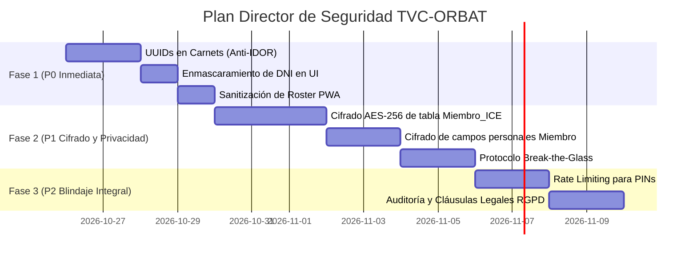

# Especificación Técnica y Plan Director: Protección de Datos y Seguridad (RGPD / LOPD-GDD)

**Proyecto:** TVC-ORBAT  
**Documento:** Plan Director de Seguridad de la Información y Cumplimiento Normativo  
**Prioridad:** **P0 (Máxima Prioridad Post-Evento)**  
**Estado:** Registrado para ejecución inmediata a partir del próximo ciclo de desarrollo  
**Fecha:** Octubre 2026  

---

## 1. Visión y Justificación

Durante el análisis del sistema se constató que **TVC-ORBAT** almacena y procesa no solo datos lúdicos o tácticos, sino **información personal identificativa y datos de salud de categoría especial (Art. 9 RGPD)** de los participantes:
* Nombres y apellidos reales, Documento Nacional de Identidad (DNI/NIF), fotografías personales.
* Teléfonos personales y correos electrónicos.
* Fichas médicas de emergencia (**ICE**): Grupo sanguíneo, alergias a fármacos/alimentos, enfermedades crónicas, medicación activa y contactos familiares directos.

El presente documento establece la hoja de ruta y la arquitectura técnica para blindar la privacidad de los jugadores, prevenir fugas de información y asegurar el cumplimiento estricto de la normativa española y europea (**RGPD / Ley Orgánica 3/2018 LOPD-GDD**).

> [!IMPORTANT]
> **Decisión Operativa del Evento Actual:**
> Conforme a la directriz de Dirección de juego, **la partida actual se ejecutará con el sistema en su estado operativo actual** para no alterar la estabilidad durante el combate.
> Las medidas de este documento quedan congeladas como **especificación técnica prioritaria (P0)** para ser implementadas de forma metódica inmediatamente después de la finalización del evento.

---

## 2. Mapa de Vulnerabilidades y Brechas Identificadas

```
[ INVENTARIO DE RIESGOS DETECTADOS ]
├── 1. Acceso Público y Enumeración de Carnets (IDOR)
│   └── Ruta /carnet/<int:id> accesible sin autenticación por ID numérico secuencial (1, 2, 3...)
├── 2. Exposición de DNI en Texto Claro
│   └── DNI completo visible en carnet físico y plantilla HTML (display-dni)
├── 3. Almacenamiento en Texto Plano (At-Rest)
│   └── Base de datos SQLite (orbat.db) almacena campos médicos y DNI sin cifrar
├── 4. Fuga de Datos Personales en PWA Offline
│   └── El snapshot del roster en localStorage almacena datos civiles en el smartphone del jugador
└── 5. Autenticación Débil de Operadores
    └── PINs numéricos de 4 dígitos sin bloqueo por fuerza bruta (Rate Limiting)
```

---

## 3. Arquitectura de Solución por Módulos

### Módulo 1: Blindaje de Acceso a Carnets y Eliminación de IDOR (P0)

1. **Tokens Criptográficos No Predecibles (UUIDv4):**
   * Sustituir las URLs secuenciales `/carnet/<int:id>` por rutas basadas en tokens criptográficos únicos aleatorios:  
     `/carnet/<string:token_acceso>` (ej: `/carnet/7f8a9b1c-3d2e-4b5a-9f1e-2c3d4e5f6a7b`).
   * Añadir columna `token_acceso TEXT UNIQUE` a la tabla `Miembro`.
   * El código QR físico solo enlazará a dicho token aleatorio.
2. **Minimización de Datos en Carnet Público:**
   * En el frontal visible del carnet solo debe figurar: **Indicativo táctico (Nick), Bando, Rol, Escuadra y UID Táctico**.
   * El DNI jamás se imprimirá completo: debe enmascararse conforme a la directriz de la AEPD: `***4567*` o eliminarse del diseño exterior.
   * La vista de carnet no incluirá nombres ni apellidos civiles salvo que el usuario inicie sesión con rol de Administración o Mando.

---

### Módulo 2: Cifrado en Reposo de Datos Sensibles (Field-Level Encryption) (P1)

1. **Cifrado Simétrico AES-256 (Fernet):**
   * Los campos críticos de salud y personales se cifrarán antes de persistir en SQLite:
     * Tabla `Miembro_ICE`: `alergias`, `condiciones_medicas`, `medicacion_actual`, `observaciones`.
     * Tabla `Miembro`: `dni`, `telefono`, `email`, `nombre_apellidos`.
   * Al consultar la BD, los valores serán ilegibles si se extrae el fichero `.db`:
     `gAAAAABk9y7...`
2. **Gestión de Claves Criptográficas:**
   * La clave maestra (`TVC_ENCRYPTION_KEY`) se cargará estrictamente desde variable de entorno del sistema (`.env`), nunca en el repositorio Git.
   * En caso de copia o sustracción física del archivo `orbat.db`, los datos de salud e identidad son matemáticamente imposibles de descifrar sin la clave del servidor.

---

### Módulo 3: Protocolo "Break-the-Glass" para Ficha Médica de Emergencia (P1)

1. **Principio de Necesidad de Conocer (*Need-to-Know*):**
   * En condiciones normales de juego, los jefes de equipo y árbitros **no** necesitan ver la lista de enfermedades ni medicación de un jugador.
   * Solo el grupo sanguíneo (crítico para evacuación en ambulancia) será visible en caso necesario.
2. **Desbloqueo Justificado de Emergencia:**
   * La consulta completa de datos ICE requerirá pulsar un botón especial:  
     `🚨 DESBLOQUEAR FICHA DE EMERGENCIA REAL`.
   * El sistema exigirá confirmar el motivo y registrará en la tabla `AuditoriaAccesoICE`:
     * `usuario_id` y rol del solicitante.
     * `miembro_id` del herido.
     * `timestamp` exacto (ISO UTC).
     * `motivo` declarado (ej. *«Accidente en barranco - Atención Cruz Roja»*).

---

### Módulo 4: Sanitización de la PWA y Almacenamiento Local (P1)

1. **Filtrado del Snapshot Offline (`/api/medic/roster`):**
   * El endpoint del roster precargado para el Service Worker de Field Medic debe purgar cualquier dato civil.
   * **Payload autorizado:** `uid`, `nombre_jugador` (Nick), `rol`, `faccion`, `equipo`, `is_medic`, `cupo_nominal`.
   * **Prohibido en payload offline:** `nombre_apellidos`, `dni`, `pin`, `telefono`, `email`, `alergias`, `condiciones_medicas`.
2. **Aislamiento en Terminales:**
   * Si un jugador pierde su terminal en combate o cae en manos de terceros, la inspección del almacenamiento local (`localStorage`) solo revelará nombres tácticos y estados del juego, garantizando la privacidad de los jugadores.

---

### Módulo 5: Blindaje contra Ataques de Fuerza Bruta (P2)

1. **Control de Reintentos de PIN (Rate Limiting):**
   * Los códigos PIN de 4 dígitos y contraseñas de equipo deben incorporar protección contra ataques automatizados:
     * Máximo 5 intentos erróneos por IP / terminal.
     * Bloqueo temporal exponencial: 5 minutos tras el 5º intento; 30 minutos tras el 8º.
2. **Cabeceras de Seguridad HTTP:**
   * En producción (PythonAnywhere), forzar cabeceras estándar:
     * `Strict-Transport-Security: max-age=31536000; includeSubDomains` (HSTS).
     * `X-Content-Type-Options: nosniff`.
     * `X-Frame-Options: SAMEORIGIN`.

---

### Módulo 6: Cumplimiento Legal y Consentimiento Informado (P2)

1. **Cláusula de Recogida de Datos Médicos (Art. 9 RGPD):**
   * En el formulario de alta de miembro o ficha de inscripción, incorporar checkbox no pre-marcado obligatorio:
     > *«Doy mi consentimiento explícito para que la organización almacene mis datos médicos (ICE) con la finalidad exclusiva de atender posibles emergencias sanitarias durante la actividad deportiva.»*
2. **Política de Conservación y Purga Post-Campaña:**
   * Los datos médicos son temporales para la seguridad del evento.
   * Incorporar función administrativa para purgar fichas ICE tras un periodo de seguridad (ej. 30 días posteriores al cierre de la edición).

---

## 4. Plan de Ejecución por Fases (Post-Evento)



---

## 5. Resumen de Tareas Técnicas a Ejecutar

| ID | Componente | Acción Técnica | Prioridad |
| :--- | :--- | :--- | :---: |
| **SEC-01** | `app.py` / `init_db.py` | Migrar `/carnet/<id>` a `/carnet/<uuid_token>`. | **P0** |
| **SEC-02** | `templates/carnet.html` | Enmascarar DNI a formato `***1234*` y ocultar nombre real en carnet público. | **P0** |
| **SEC-03** | `field_medic/medic_engine.py` | Excluir datos civiles del snapshot JSON generado en `get_medic_roster_snapshot`. | **P0** |
| **SEC-04** | `init_db.py` / `app.py` | Implementar capa de encriptación AES-256 (Fernet) para campos médicos de `Miembro_ICE`. | **P1** |
| **SEC-05** | `app.py` / `templates` | Crear flujo «Break-the-Glass» con registro en tabla `AuditoriaAccesoICE`. | **P1** |
| **SEC-06** | `app.py` | Incorporar limitador de intentos para logins y desbloqueos con PIN. | **P2** |
| **SEC-07** | `templates/index.html` | Formulario de consentimiento informado y botón de purga médica post-evento. | **P2** |
